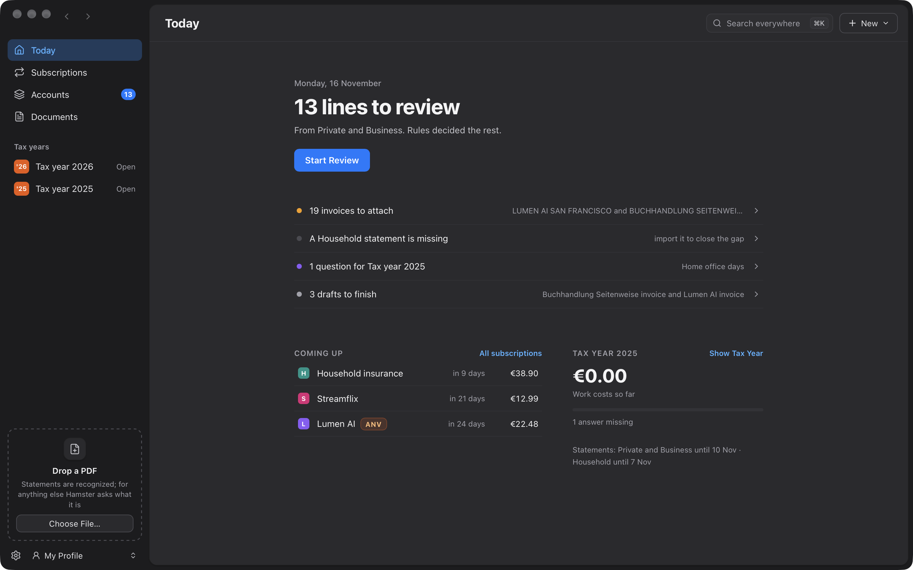
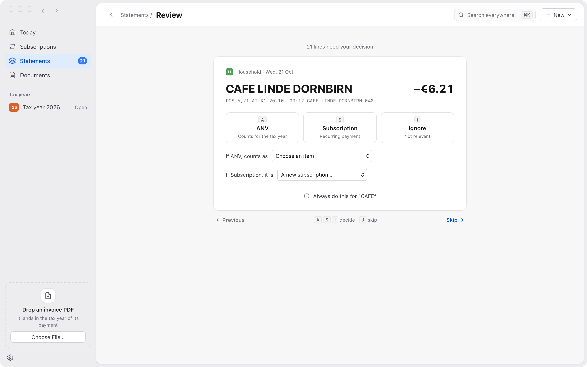
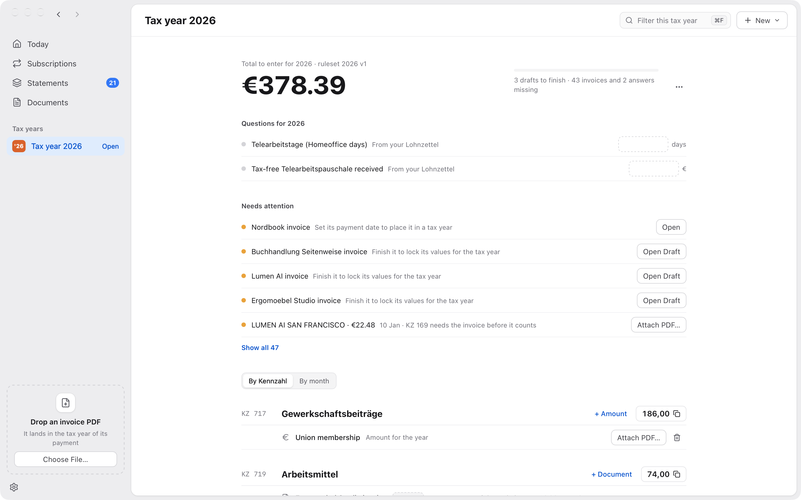
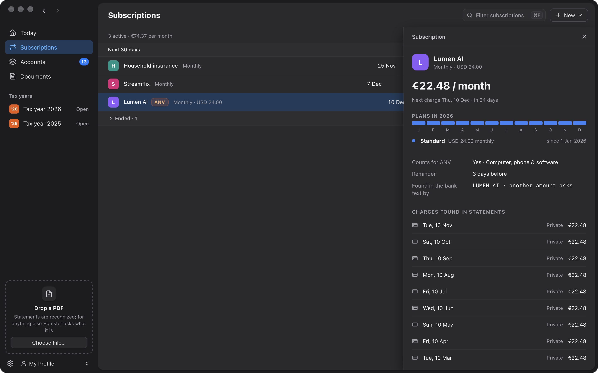
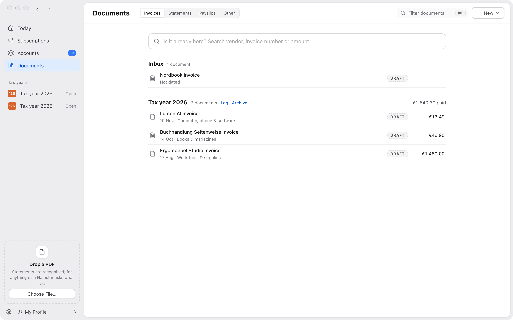
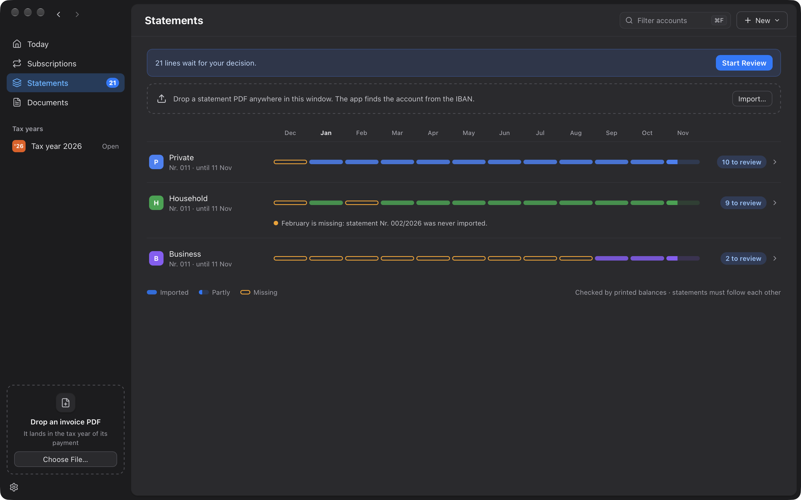

# Finance Hamster

My offline money archive for macOS. It hoards every invoice and bank statement so none gets lost, asks only
what it can't know, and ends each tax year with the numbers to type into the tax return.

It does three jobs for one person on one Mac:

- **Work expenses for the tax return.** In Austria, employees claim work-related costs (*Werbungskosten*) in
  their yearly return (*Arbeitnehmerveranlagung*, ANV) on the tax office's portal, FinanzOnline, one total per
  form field (*Kennzahl*). Hamster collects the invoices with the euro amount actually paid and files them by
  payment date. It spreads larger purchases over their useful life and shows one value per Kennzahl to copy.
- **Bank statements as a permanent record.** It imports the bank's PDF statements and checks their printed
  balances and numbering. It decides most lines with rules and keeps every statement as it was printed.
- **Subscriptions.** It tracks what renews when, what it costs per month, and how each price changed.

It is a local tool for one person on one Mac. Published as source, as-is: no releases, no binaries, no
support. To build it or port it, point a coding agent at [AGENTS.md](AGENTS.md).



## What it does

- **Today:** the single most useful next step with one button (review new lines, attach invoices, import an
  overdue or missing statement, run the year check, finish drafts), the rest as quiet rows, the next charges
  and the tax year so far.
- **Statements:** drop a PDF anywhere in the window and the account is found by its IBAN. Nothing is stored
  until the balances add up. A coverage bar per account shows each month as imported, partly imported or
  missing, and a statement that was never imported is named.
- **Review:** one line at a time, with only the question Hamster can't answer: a work expense (ANV), a
  subscription, or nothing to do. A or S or I picks, and Return confirms the sentence that says what will
  happen. Select any text on the line, such as a contract number, to make a rule that decides every such line
  from now on.
- **Subscriptions:** found in the statements by their bank text. A charge at the plan's amount is booked. A
  charge at another amount asks: a new price, a one-off, or not this subscription. A subscription takes one
  charge per period, so a second charge the next day isn't mistaken for it.
- **Documents:** drop an invoice PDF and Hamster reads the vendor, amount and date, and finds the bank line
  that paid it. Finished documents are locked; deleting one needs a reason and is logged.
- **The tax year:** one copy value per Kennzahl with the documents, amounts and trips behind it, rules from a
  JSON file per year (edited outside the app, frozen with a closed year), and a year check in November that
  asks about the deductions people forget.
- **Keyboard first:** ⌘K finds anything and runs any command, every action has a menu item and a shortcut, and
  the `hamster` command line drives the running app.

| | |
|---|---|
|  |  |
|  |  |
|  | |

All screenshots show made-up demo data from the debug build (`scripts/dev/screens.sh`).

## Privacy and persistence

- **No network at all:** the app contains no HTTP client, and a test checks the dependency tree for one. PDF
  text and previews come from macOS's own PDFKit.
- **One folder:** everything lives in one SQLite file plus the original PDFs in
  `~/Library/Application Support/com.philippstracker.hamster/`. Original PDFs are never modified.
- **Nothing disappears by accident:** every change is a journaled operation, mirrored to an append-only
  `journal.jsonl`, and can be undone. Finished documents and closed tax years are locked; reopening is an
  explicit, logged act.
- **Not included:** budgeting, bookkeeping, tax calculation, bank connections, multiple users or sync.

## Install

```sh
bun install
scripts/create-signing-cert.sh   # once per Mac, only without an Apple Development certificate
bun run tauri build && scripts/install.sh
```

This builds `Hamster.app`, links it into `~/Applications` and the `hamster` command into `~/.local/bin`. It
runs on macOS on Apple Silicon only. The statement parser reads one bank's layout (Erste Bank and Sparkasse's
"George" PDF); other banks need a parser of their own (`src-tauri/src/statements/parse/`).

## CLI

The app binary is also its command line, and talks to the running app.

| Command | Does |
|---|---|
| `hamster` | starts Hamster, or brings the running one to the front |
| `hamster --hidden` | starts without showing the window |
| `hamster status` | whether it runs, its version and its window |
| `hamster show`, `focus`, `hide`, `quit` | shows the window (`focus` also brings it to the front), hides it, quits |
| `hamster commands` | every command with its id and shortcut |
| `hamster run <command-id>` | runs a command as its menu item would, e.g. `go:statements`, `app:settings` |

`--json` prints any reply as JSON.

## Docs

[docs/README.md](docs/README.md) is the index of the technical documentation; [docs/adr/](docs/adr/README.md)
records why the design is the way it is.

## License

MIT, see [LICENSE](LICENSE).
